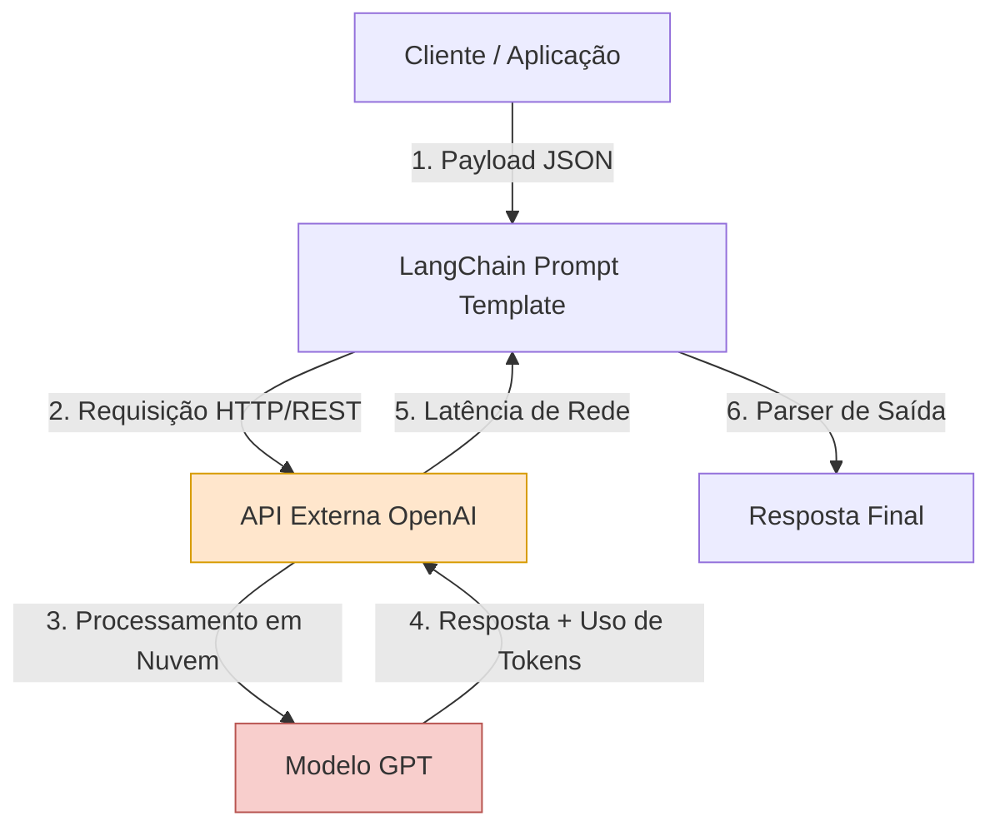

# Parte 2 - Questão 4: Análise de Limitações da API da OpenAI via LangChain

Este documento apresenta uma análise crítica das limitações técnicas, financeiras e operacionais ao integrar a API da OpenAI por meio do ecossistema LangChain, tomando como base a arquitetura de tradução desenvolvida na Questão 2 (Parte 2).

---

## 1. Fluxo de Integracão e Gargalos Operacionais

O diagrama abaixo ilustra o fluxo de uma requisição utilizando LangChain e a API externa da OpenAI, destacando os pontos de latência, custo e dependência de rede:

---

## 3. Discussão Técnica

### A. Desempenho e Latência de Resposta
* **Conexão Externa:** Dependência direta do *Round-Trip Time* (RTT) de rede e da estabilidade da conexão com os servidores da OpenAI.
* **Overhead do Framework:** Tempo adicional gasto pelo LangChain no processamento e formatação dos prompts e saídas.
* **Fila no Provedor:** Variabilidade na latência em momentos de alta demanda global nos servidores remotos.

### B. Limites de Uso (Rate Limits)
* **Restrições de RPM/TPM:** Limites rígidos de requisições e tokens por minuto vinculados ao plano (*Tier*) da conta.
* **Erros de Throttling (HTTP 429):** Necessidade de tratar exceções de cota no pipeline com estratégias de *retry*.

### C. Desafios de Escalabilidade e Custo
* **Cobrança por Token:** Custo financeiro dinâmico que cresce de acordo com o volume de tokens enviados e recebidos.
* **Dependência (Vendor Lock-in):** Vulnerabilidade a mudanças de preços, políticas e descontinuação de modelos pelo provedor.
* **Gestão de Credenciais:** Exigência de controle seguro de *API Keys* e limitação de gastos por ambiente.

### D. Qualidade das Traduções (GPT vs. Modelos Dedicados)
* **Genérico vs. Especializado:** Modelos *Seq2Seq* dedicados (como `MarianMT` ou `Helsinki-NLP`) costumam ser mais precisos e eficientes para tradução direta do que LLMs genéricos.
* **Engenharia de Prompt:** O modelo GPT pode incluir texto extra na resposta, exigindo o uso de prompts defensivos e parsers estritos no LangChain.

---

## 4. Conclusão

A API da OpenAI via LangChain acelera a prototipagem, mas para sistemas em produção com foco em controle de custo, baixa latência e privacidade, modelos *open-source* locais são mais vantajosos.