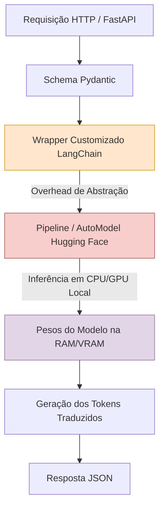

# Parte 2 - Questão 5: Análise de Limitações do LangChain com Modelos Hugging Face Locals

Este documento analisa as limitações operacionais, computacionais e de arquitetura ao utilizar o ecossistema LangChain como camada de abstração para modelos Hugging Face locais, tendo como referência a API desenvolvida na Questão 3 (Parte 2).

---

## 1. Fluxo da Arquitetura Local

O diagrama a seguir ilustra o caminho da requisição na aplicação local, destacando as camadas de abstração e os pontos de consumo de recursos:

---

## 3. Discussão Técnica

### A. Desempenho e Tempo de Resposta
* **Overhead da Abstração:** Acréscimo marginal de tempo de processamento devido às camadas de abstração e wrappers do LangChain.
* **Gargalo de CPU Local:** Em máquinas sem aceleração por GPU, o tempo de inferência token a token é limitado pela capacidade do processador local.
* **Cold Start:** Tempo elevado exigido para carregar os pesos do modelo na memória RAM no momento da inicialização do servidor.

### B. Consumo de Recursos Computacionais
* **Uso Contínuo de Memória:** Alocação permanente da memória RAM/VRAM para manter os pesos do modelo prontos para inferência, mesmo sem tráfego.
* **Saturação do Processador:** Elevação do uso de CPU para 100% durante o processamento da tradução, podendo impactar a concorrência do FastAPI/Uvicorn.

### C. Limitações no Ajuste Fino (Fine-Tuning)
* **Foco em Orquestração:** O LangChain foi concebido para inferência e fluxo de dados, não possuindo rotinas para rotinas de treino, retropropagação ou cálculo de *loss*.
* **Uso de Bibliotecas Nativas:** A realização do *fine-tuning* exige sair da camada do LangChain e utilizar rotinas nativas do PyTorch/Hugging Face (`Trainer`, `LoRA`, `PEFT`).

### D. Execução Local vs. API Hospedada (Hugging Face)
* **Privacidade e Custos:** A execução local garante 100% de soberania sobre os dados e custo por requisição nulo, dependendo contudo do hardware local.
* **Flexibilidade de Configuração:** A abordagem local permite ajustar livremente parâmetros de geração (como *beam search*, *temperature* e limite de tokens) diretamente no código Python.

---

## 4. Conclusão

Usar LangChain com modelos locais garante privacidade e custo previsível, mas exige hardware adequado para manter bom desempenho em cenários com muitas requisições simultâneas.