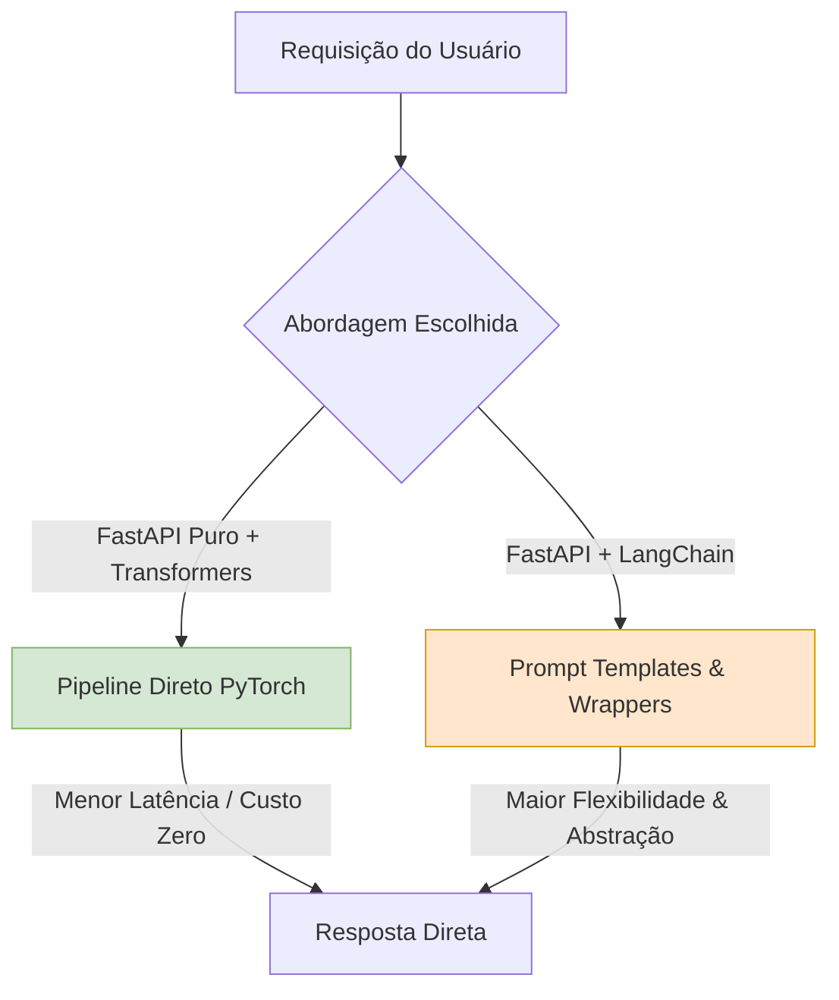

# Parte 2 - Questão 6: Tabela Comparativa - FastAPI Puro vs. LangChain

## 1. Descrição e Objetivo

Este documento apresenta uma análise comparativa entre as abordagens de desenvolvimento utilizadas no projeto: o uso de **FastAPI Puro** com bibliotecas nativas de Deep Learning (`transformers`/`torch`) e o uso da abstração do **LangChain** (integrado a modelos locais ou APIs remotas).

---

## 2. Diagrama da Arquitetura Comparativa

---

## 3. Tabela Comparativa

| Critério | FastAPI Puro (com Transformers/PyTorch) | LangChain (Integrado com LLMs/APIs) |
| :--- | :--- | :--- |
| **Facilidade de uso / configuração** | Exige código explícito para carregar modelos, tokenizar textos e tratar exceções nativas. Maior controle inicial, mas menos utilitários pré-prontos. | Alta abstração com classes prontas (`PromptTemplate`, `LLMChain`, parsers). Reduz o código boilerplate para criar fluxos complexos. |
| **Latência e desempenho** | **Menor latência.** Inferência direta sem camadas intermediárias de abstração. O desempenho depende apenas do hardware (CPU/GPU local). | **Latência ligeiramente maior.** Wrappers e parsers adicionam overhead. Se integrado a APIs externas (ex: OpenAI), depende também do RTT da rede. |
| **Flexibilidade para diferentes modelos** | Limitado ao ecossistema PyTorch/Hugging Face nativo. Trocar de arquitetura pode exigir reescrever rotinas de pré e pós-processamento. | **Altíssima flexibilidade.** Permite trocar a fonte do modelo (OpenAI, Hugging Face local, Ollama) alterando poucas linhas de configuração. |
| **Custo e escalabilidade** | **Custo previsível/zero por requisição.** Roda 100% local, mas exige investimento em infraestrutura de hardware para escalabilidade horizontal. | **Custo dinâmico (se usar APIs externas).** O modelo pay-per-token escala com o uso. Em uso local, herda os custos de hardware do FastAPI puro. |
| **Adequação para protótipos vs. produção** | **Ideal para Produção Especializada.** Excelente para microsserviços de baixa latência, escopo fixo e tarefas dedicadas (ex: tradução *Seq2Seq*). | **Ideal para Protótipos e Agentes.** Perfeito para validação rápida de ideias, pipelines de RAG e aplicações que exigem encadeamento complexo de prompts. |

---

## 4. Conclusão

O **FastAPI Puro** com bibliotecas nativas (`transformers`, `torch`) é a melhor escolha para microsserviços de produção focados em alto desempenho, custos previsíveis e tarefas específicas de NLP. Por outro lado, o **LangChain** destaca-se na prototipagem rápida e na construção de sistemas complexos baseados em agentes e LLMs genéricos, onde a facilidade de orquestração supera a necessidade de latência mínima.